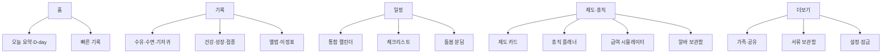

# 네스토리(Nestory) — Design PRD v0.1

> 작성: 2026-10-20 · 상태: 초안
> 관련 문서: [PRD_Tech.md](PRD_Tech.md) · [TASKS.md](TASKS.md) · [BLENDER_ASSET_BRIEF.md](BLENDER_ASSET_BRIEF.md)

## 1. 디자인 방향

**한 줄 요약: "포근한 파스텔 클레이 인형 세계"**

| 키워드 | 의미 | 적용 |
|---|---|---|
| 포근함 | 불안한 시기의 부모를 안심시킨다 | 크림 배경, 낮은 채도, 부드러운 그림자 |
| 아기자기 | 작고 귀여운 디테일이 발견되는 재미 | 스티커·마스코트·빈 화면 일러스트·햅틱 |
| 또렷함 | 새벽 3시 수유 중에도 한 손으로 쓴다 | 큰 터치 영역(≥56pt), 대비 AA, 야간 모드 |
| 믿음직함 | 제도·금액 정보는 정확하고 차분하게 | 귀여움은 장식, 숫자·표는 깔끔한 정보 디자인 |

원칙
1. **귀여움은 감정 지점에만** (완료, 빈 화면, 성장 기록, 축하). 정보 밀집 화면(휴직 시뮬레이터, 표)은 절제한다.
2. **한 손 우선**: 핵심 동작은 화면 하단 절반에서 끝낸다.
3. **밤 모드는 기능**: 수유 중 쓰는 어두운 모드(저휘도·적색 계열 악센트).
4. Liquid Glass 는 **내비게이션/컨트롤 레이어**에만 쓴다. 콘텐츠 카드는 불투명 파스텔 면으로 구분한다.

## 2. 마스코트 "네스티"
- 동글동글한 아기 곰 인형 + 포근한 담요 망토. 눈은 점, 볼에 연한 분홍 블러시.
- 표정 세트: 기본, 방긋, 졸림(수면), 먹는 중(수유), 응원(휴직·복직), 걱정(경고), 축하(완료).
- 용도: 온보딩, 빈 화면, 알림 카드, 성취 스티커, 앱 아이콘.
- 제작: Blender 클레이 느낌 3D 렌더 → 투명 PNG(@1x/2x/3x) + visionOS 용 USDZ. 의뢰서는 [BLENDER_ASSET_BRIEF.md](BLENDER_ASSET_BRIEF.md).
- 보조 캐릭터 없음(범위 제한). 대신 **스티커 오브젝트**(젖병, 기저귀, 딸랑이, 달, 별, 구름, 발자국, 하트, 과일 크기 비교)로 풍성함을 만든다.

## 3. 색상

### 3.1 팔레트 (라이트)
| 토큰 | HEX | 용도 |
|---|---|---|
| `cream` | `#FFF8EF` | 앱 배경 |
| `milk` | `#FFFFFF` | 카드(보조 면) |
| `peach` | `#FFB59E` | 메인 악센트, 주요 버튼 |
| `peachDeep` | `#B24A33` | 크림 위 강조 텍스트·아이콘 (구 `#E8826A` 는 대비 2.5:1 로 AA 미달이라 조정) |
| `mint` | `#A8E0CF` | 수유·건강 계열 |
| `butter` | `#FFE08A` | 일정·알림 계열 |
| `lavender` | `#CBB8F0` | 수면 계열 |
| `sky` | `#B8DDF5` | 기저귀·성장 계열 |
| `rose` | `#F6B6C8` | 임신·가족 계열 |
| `cocoa` | `#5A4340` | 본문 텍스트 (cream 위 대비 약 8:1 목표) |
| `cocoaSoft` | `#7A6360` | 보조 텍스트 (구 `#8A7370` 은 4.2:1 로 미달이라 조정) |
| `onPastel` | `#5A4340` | 파스텔 면 위 글자 (라이트·다크 공통) |
| `warning` | `#F2B33D` | 확인 필요(휴직 중 소득 경고 등) — 면 전용, 위 글자는 `onPastel` |
| `danger` | `#C23B38` | 오류, 응급 안내 (다크 `#FF8A85`) |

### 3.2 카테고리 색 (기록 종류 = 색 + 아이콘, 색만으로 구분 금지)
| 종류 | 색 | SF Symbol 후보 |
|---|---|---|
| 수유 | mint | `drop.fill` / 커스텀 젖병 |
| 수면 | lavender | `moon.zzz.fill` |
| 기저귀 | sky | 커스텀 기저귀 |
| 건강(체온·투약) | rose | `thermometer.medium`, `pills.fill` |
| 성장 | butter | `chart.line.uptrend.xyaxis` |
| 일정 | butter | `calendar` |
| 휴직·제도 | peach | `briefcase.fill` |
| 알바 | sky | `figure.and.child.holdinghands` 또는 커스텀 |

### 3.3 다크 / 밤 모드
| 토큰 | 다크 HEX |
|---|---|
| `cream`(배경) | `#1E1A19` |
| 카드 | `#2A2423` |
| `cocoa`(본문) | `#F4E9E2` |
| `cocoaSoft` | `#CDBBB3` |
| `peach` | `#FFA58A` |
- **밤 수유 모드**(수동/자동): 밝기 낮춤, 악센트를 호박색 `#FFB870` 단일색으로, 화면 켜짐 유지, 큰 타이머 중심.
- 파스텔 위 텍스트는 `cocoa`(어두운 색)만 사용, 흰 글자 금지. 모든 조합 WCAG AA(4.5:1)는 `NestoryUITests/ContrastTests` 가 자동 검증한다(색을 바꾸면 이 테스트부터 통과시킬 것).

## 4. 타이포그래피
- 기본: **시스템 폰트 + `.fontDesign(.rounded)`** (영문/숫자 SF Rounded, 한글은 시스템 한글).
- 한글 포인트 폰트(선택): 제목·마스코트 말풍선에 **Gowun Dodum** 또는 **Jua**(둘 다 SIL OFL). 번들 전 라이선스 파일 포함·크기 확인 필요(T0 결정).
- 숫자(D-day, 금액, 타이머)는 `monospacedDigit` 로 흔들림 방지.
- 모두 **텍스트 스타일(Dynamic Type) 기반**, 고정 크기 금지.

| 역할 | 스타일 | 비고 |
|---|---|---|
| 큰 수치 (D-day) | `.largeTitle` rounded bold | 홈 히어로 |
| 화면 제목 | `.title2` | |
| 카드 제목 | `.headline` | |
| 본문 | `.body` | 한글 줄간격 +2pt |
| 보조 | `.footnote` | cocoaSoft |

## 5. 모양·여백·모션
- 모서리: 카드 24pt, 버튼 캡슐형, 작은 칩 12pt, 연속 곡률(`.continuous`).
- 그림자: 블러 16 · y4 · peach 8% (차가운 회색 그림자 금지).
- 간격 스케일: 4 · 8 · 12 · 16 · 24 · 32.
- 터치 영역 최소 44pt, 기록 버튼 56pt 이상.
- 모션: 스프링(응답 0.4, 감쇠 0.75). 완료 시 스티커가 "톡" 붙는 애니메이션 + 가벼운 햅틱(iOS). **모션 감소 설정 시 페이드로 대체.**
- 소리: 기본 무음, 선택적으로 딸랑이 효과음(설정).

## 6. 컴포넌트 (NestoryUI)
| 컴포넌트 | 설명 |
|---|---|
| `NestoryCard` | 파스텔 면 + 24pt 모서리 + 부드러운 그림자, 상단 스티커 슬롯 |
| `QuickLogButton` | 큰 원형/캡슐 기록 버튼, 카테고리 색+아이콘+라벨, 길게 눌러 상세 |
| `TimerRing` | 수유/수면 타이머 링, 경과시간 중앙 |
| `WeekHero` | 임신 주차/출생 후 일수 히어로 카드, 과일 크기 스티커 |
| `StickerView` | 투명 PNG 스티커, 접근성 레이블 필수 |
| `TimelineRow` | 일정/검진/접종 공통 행, 완료 체크 스티커 |
| `LeaveGantt` | 부부 휴직 간트(두 줄 레인), 겹침 하이라이트, 드래그 편집 |
| `MoneyBar` | 월별 예상 소득 막대 + 부부 합산 라인 |
| `DisclaimerBanner` | "참고용 · 기준일 · 출처" 상시 배너(제도 화면) |
| `EmptyState` | 마스코트 + 한 줄 안내 + 주 버튼 |
| `Chip` | 필터·태그(재택, 단시간 등) |

## 7. 화면 구조

### 7.1 정보 구조

### 7.2 모드 전환
앱은 아이 상태에 따라 홈 구성을 바꾼다.
| 상태 | 홈 히어로 | 우선 노출 |
|---|---|---|
| 임신 중 | "임신 N주 M일 · 출산까지 D-X" | 다음 검진, 바우처, 준비물 |
| 출산 직후(0~100일) | "태어난 지 N일" | 빠른 기록, 접종, 산후 휴가 |
| 육아기 | "만 N개월" | 기록 요약, 성장, 휴직 일정 |
| 복직 준비 | "복직까지 D-X" | 근로시간 단축, 어린이집 |

### 7.3 주요 화면 목록 (와이어프레임 대상)
1. 온보딩 (가족 만들기 → 임신/출산 상태 → 출산예정일 → 보호자 초대 → 알림 허용)
2. 홈 (모드별)
3. 빠른 기록 시트 / 수유 타이머 / 밤 모드
4. 기록 목록 + 일간·주간 차트
5. 성장 곡선 (백분위 밴드)
6. 예방접종·검진 목록
7. 통합 캘린더 / 체크리스트
8. 제도 카드 목록 → 제도 상세
9. 내 상황 입력 → 휴직 플래너 (간트) → 급여 시뮬레이터 결과
10. 알바 보관함(칸반) → 공고 상세 → 사전 점검 체크리스트
11. 가족·공유, 서류 보관함, 설정

## 8. 플랫폼별 디자인

### 8.1 iPhone
- 하단 탭 5개: 홈 · 기록 · 일정 · 제도 · 더보기. Liquid Glass 탭바.
- 홈 하단에 떠 있는 **기록 버튼 3개**(수유/수면/기저귀)와 "더보기(+)" — 엄지 영역.
- 시트는 `presentationDetents`(medium/large), 드래그 인디케이터 유지.

### 8.2 iPad
- `NavigationSplitView` 3열: 사이드바(모듈) · 목록 · 상세.
- 가로 모드 홈: 좌 요약 / 우 타임라인 2열. 휴직 플래너는 전체 폭 간트.
- 멀티태스킹(Split View/Stage Manager) 대응: 창 크기에 따라 컴팩트 ↔ 레귤러 전환, 방향 고정 가정 금지.
- Apple Pencil: 앨범·일기 손글씨 메모(P2).

### 8.3 macOS
- 사이드바 + 툴바 + 인스펙터(우측)로 데스크톱 관례 준수. 메뉴 막대 명령(새 기록 ⌘N, 타이머 ⌘T), 키보드 단축키.
- `MenuBarExtra`: 마지막 수유 경과시간 + 빠른 기록 3버튼.
- 윈도우 최소 폭 900pt, 간트는 마우스 드래그·확대/축소.
- 파스텔 배경은 약간 투명한 vibrancy 대신 불투명 `cream` 유지(가독성).

### 8.4 visionOS (2단계)
- 유리 윈도우 위에서 **카드 배경은 불투명 파스텔 대신 반투명 유리 + 파스텔 악센트**로 조정(글래스 위 가독성 우선).
- 터치 영역 60pt 이상, 호버 효과 필수, 텍스트는 시스템 기본보다 크게.
- 공간 경험: 성장 앨범(공간 사진 갤러리), 주차별 아기 크기(볼륨), 아기방 배치(몰입), 휴직 플래너(큰 윈도우).
- 마스코트는 USDZ 로 볼륨에 서 있는 연출(탭하면 표정 변화).
- z<0 콘텐츠가 유리 뒤로 가려지는 문제를 피하려고 앞쪽 배치(사전 학습된 제약).

### 8.5 공통 위젯/Live Activity
| 항목 | 크기 | 내용 |
|---|---|---|
| D-day 위젯 | S | 임신 주차 or 생후 N일 + 마스코트 |
| 다음 일정 | M | 가장 가까운 3개 |
| 수유 경과 | S/잠금화면 | 마지막 수유 후 시간 + 탭 시 기록 |
| 수유/수면 타이머 | Live Activity | 다이내믹 아일랜드 컴팩트 = 타이머, 확장 = 종료/좌우 선택 |

## 9. 앱 아이콘 (플랫폼별)

### 9.1 컨셉
크림→피치 그라데이션 배경 위에 **네스티 얼굴 정면**, 이마 위에 작은 별 하나(출산·희망). 마스코트가 중앙에서 약 62% 크기, 가장자리 여백 충분히.
- 단일 모티프, 텍스트 없음.
- 3D 클레이 렌더 + 부드러운 앰비언트 오클루전.

### 9.2 산출물 목록
| 플랫폼 | 형식 | 파일 규격 |
|---|---|---|
| iOS / iPadOS | 1024×1024 전체 사각형(모서리 마스크는 시스템) | 라이트(기본), 다크(배경 어둡게), 틴티드(단색 실루엣) 3종 |
| macOS | 1024 캔버스 안 둥근 사각 본체 약 824pt + 그림자 | 시스템 규격 마스크 직접 포함 PNG (표준 10개 크기 파생: 16~1024, @1x/@2x) |
| visionOS | **3개 레이어** 1024×1024: 배경(불투명), 중간(투명 PNG: 별·구름), 전경(투명 PNG: 네스티) | 원형으로 마스킹되어 시차 표시됨, 레이어 간 깊이 차 확보 |
| Icon Composer | 레이어 PNG + 그룹 구성 | Xcode 의 Icon Composer(.icon)에서 위 레이어를 조합, Liquid Glass 반영 확인 |

체크
- 작은 크기(16~29pt)에서 얼굴 윤곽이 읽히는지 확인(눈·귀 단순화 버전 별도).
- 라이트/다크/틴티드에서 모두 대비 확보.
- 마케팅용 1024 렌더도 별도 보관.

## 10. 에셋 목록 (Blender 제작 대상)
| 분류 | 항목 | 수량 | 형식 |
|---|---|---|---|
| 마스코트 | 네스티 표정 7종 | 7 | PNG 투명 1024 + USDZ 1(기본) |
| 스티커 | 젖병, 기저귀, 딸랑이, 달, 별, 구름, 발자국, 하트, 곰인형 | 9 | PNG 투명 512@3x |
| 과일 크기 비교 | 임신 주차 대표 과일/사물 (씨앗~수박, 약 14종) | 14 | PNG 투명, visionOS 볼륨용 USDZ(선택) |
| 빈 화면 | 마스코트 + 소품 구성 4장 | 4 | PNG 투명 |
| 앱 아이콘 | iOS 3종, macOS, visionOS 3레이어 | — | PNG |
| 온보딩 | 일러스트 3장 | 3 | PNG |
세부 규격은 [BLENDER_ASSET_BRIEF.md](BLENDER_ASSET_BRIEF.md).

## 11. 접근성
- VoiceOver: 모든 스티커·기록 버튼에 레이블/값/힌트, 차트는 요약 텍스트 제공.
- Dynamic Type: 최대 접근성 크기(AX5)에서 레이아웃 붕괴 없음(스크롤·세로 스택 전환).
- 대비: 팔레트 조합 자동 검증. 색 단독 의미 전달 금지(아이콘/문자 병행).
- 모션 감소·투명도 감소·굵은 글자 설정 존중.
- 알림 문구는 불안 유발 표현을 피하고 해야 할 일 중심("이번 주 막달 검사 예약 어떠세요?").

## 12. 톤 & 마이크로카피
- 존댓말(해요체), 짧고 따뜻하게. 의학·법률 표현은 단정 대신 "참고하세요 / 확인해 보세요".
- 예: "오늘도 수고했어요. 마지막 수유는 2시간 전이에요.", "육아휴직 신청은 시작 30일 전까지 회사에 알려야 해요(기준일 확인)."
- 경고: "이 금액은 급여에 영향을 줄 수 있어요. 고용센터(1350)에 먼저 확인해 보세요."

## 13. 디자인 산출물 일정(요약)
[TASKS.md](TASKS.md) 의 D 트랙 참조.
