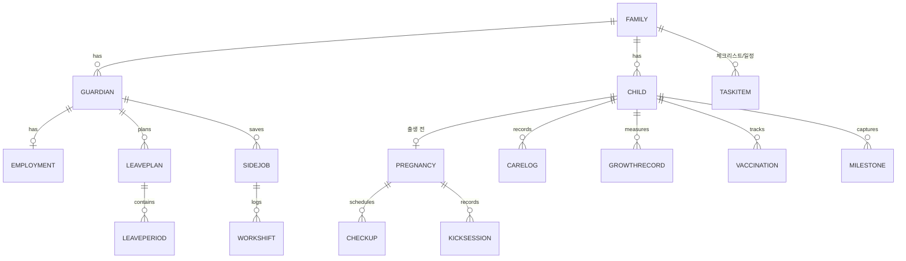

# 네스토리(Nestory) — Tech PRD v0.1

> 작성: 2026-10-20 · 상태: 초안 · 대상: iPhone / iPad / macOS (1단계) → visionOS (2단계)
> 관련 문서: [PRD_Design.md](PRD_Design.md) · [TASKS.md](TASKS.md) · [BLENDER_ASSET_BRIEF.md](BLENDER_ASSET_BRIEF.md)

## 1. 제품 정의

**네스토리**은 아이를 기다리는 날(임신 확인)부터 육아·복직까지, 한국 가정이 마주치는 일정·기록·제도·소득을 한 곳에서 관리하는 가족용 앱이다.

### 1.1 목표
1. 임신 주차를 기준으로 **해야 할 일을 자동 생성**한다 (검진, 바우처, 준비물, 출생신고 등).
2. 출산 후 **육아 기록**(수유·수면·기저귀·체온·투약·성장)을 3탭 이내로 입력한다.
3. **휴가·휴직 제도**(출산전후휴가, 배우자 출산휴가, 육아휴직, 육아기 근로시간 단축)를 계획·시뮬레이션하고 신청 기한을 알려준다.
4. **휴직 중 아르바이트** 정보를 모으고, 근무·수입이 급여에 미칠 영향을 *사전 점검*한다.
5. 부부(보호자)가 **같은 데이터를 공유**한다.
6. 아기 데이터는 **온디바이스 + 개인 iCloud**에만 둔다. 자체 서버·분석 SDK 없음.

### 1.2 비목표 (v1)
- 의료 진단·처방 조언, 법률/노무 자문 (모든 제도 계산은 "참고용" 고지)
- 자체 백엔드, 계정 시스템, 광고
- 커뮤니티/SNS, 쇼핑
- Android / 웹

### 1.3 사용자
| 페르소나 | 설명 | 핵심 니즈 |
|---|---|---|
| 예비 엄마 | 임신 12주, 직장인 | 검진 일정, 바우처, 출산휴가 계산 |
| 예비/신생아 아빠 | 배우자 출산휴가·육아휴직 고민 | 휴가 분할 계획, 급여 시뮬레이션 |
| 육아휴직 중 부모 | 소득 공백 | 단기·재택 일자리 정보, 급여 영향 점검 |
| 조부모/돌봄자 (읽기 전용) | 가끔 돌봄 | 오늘의 수유·수면 상태, 응급 연락처 |

## 2. 기능 범위

기능은 6개 모듈로 나눈다. 우선순위 P0 = 1단계 필수, P1 = 1단계 후반, P2 = 이후.

### 2.1 M1 · 임신·출산 준비 (`Prenatal`)
| 기능 | P | 설명 |
|---|---|---|
| 출산예정일 계산 | P0 | 마지막 생리일(네겔레 법칙)·초음파 보정·IVF 이식일 3가지 입력 |
| 주차 타임라인 | P0 | 주차별 아기 크기/산모 변화 카드, 과일 비유 일러스트 |
| 산전검사 일정 자동 생성 | P0 | 1차/2차 기형아 검사, 정밀 초음파, 임신성 당뇨, 막달 검사 등 (규칙 데이터) |
| 체크리스트 | P0 | 출산 준비물, 입원 가방, 아기방, 행정 절차 (템플릿 + 사용자 항목) |
| 바우처·지원금 안내 | P0 | 임신·출산 진료비 바우처, 첫만남이용권 등 — 신청 시점/방법/링크 |
| 태동 카운터 | P1 | 시작/탭/종료, 기록 저장 |
| 진통 타이머 | P1 | 간격·지속시간 자동 계산, "병원 갈 시간" 기준 알림 |
| 산모 기록 | P1 | 체중·혈압·혈당 수동 기록 + 차트 (HealthKit 연동은 P2, 선택) |
| 병원/조리원 관리 | P1 | 연락처·예약·메모 |
| 태명/이름 후보 | P2 | 후보 비교 투표(부부) |

### 2.2 M2 · 육아 기록 (`Care`)
| 기능 | P | 설명 |
|---|---|---|
| 빠른 기록 | P0 | 수유(모유 좌/우·분유 ml·이유식), 수면, 기저귀(소변/대변/색), 체온, 투약 |
| 타이머 | P0 | 수유·수면 타이머, Live Activity / 잠금화면 / macOS 메뉴바 |
| 일간·주간 요약 | P0 | Swift Charts, 패턴 시각화 |
| 성장 기록 | P0 | 키·몸무게·머리둘레 + 소아청소년 성장도표 백분위 곡선 |
| 예방접종 | P0 | 국가예방접종 일정 자동 생성, 접종 완료 체크, 다음 접종 알림 |
| 영유아 건강검진 | P0 | 시기별 검진 일정·문진표 안내 |
| 발달 이정표 | P1 | 뒤집기·앉기·첫 걸음 등 기록 + 사진 |
| 이유식/알레르기 | P1 | 새 식재료 시도 로그, 반응 기록 |
| 앨범·일기 | P1 | 월령 스티커, 100일/돌 카드 |
| 자연어 입력 | P1 | 온디바이스 모델: "어젯밤 11시 분유 120" → 기록 (§6) |
| 의사 방문용 요약 PDF | P2 | 기간 선택 → 내보내기 |

### 2.3 M3 · 가족 일정 (`Schedule`)
| 기능 | P | 설명 |
|---|---|---|
| 통합 타임라인 | P0 | 검진·접종·휴직·알바·사용자 일정을 하나의 캘린더 뷰로 |
| 알림 | P0 | 로컬 알림(D-7/D-1/당일), 조용한 시간 |
| 캘린더 연동 | P1 | EventKit 내보내기/동기화 (선택) |
| 돌봄 분담표 | P1 | 부부·조부모 교대 근무표, 밤수 분담 |
| 위젯 | P0 | D-day, 다음 일정, 마지막 수유 후 경과시간 |

### 2.4 M4 · 휴가·휴직 (`Leave`)
핵심 차별점. 제도 계산은 **규칙 데이터(§5.3)** 로 분리해 법령 개정에 앱 업데이트 없이 대응한다.

| 기능 | P | 설명 |
|---|---|---|
| 내 상황 입력 | P0 | 근로형태, 입사일, 통상임금(월), 고용보험 가입, 다태아 여부 |
| 제도 카드 | P0 | 출산전후휴가, 배우자 출산휴가, 육아휴직, 육아기 근로시간 단축, 가족돌봄 등 — 대상·기간·급여·신청 방법 |
| 휴직 플래너 | P0 | 부부 타임라인(간트)에서 기간 배치, 겹침·한도 검증 |
| 급여 시뮬레이터 | P0 | 월별 예상 급여/수당, 부부 합산 소득 비교, 시나리오 3개 저장 |
| 신청 마감 알림 | P0 | 사업주 사전 통지, 급여 신청 주기 등 단계별 체크리스트 |
| 연차·출근율 계산 | P1 | 휴직 기간의 출근율 간주 반영한 연차 잔여 추정 |
| 서류 보관함 | P1 | 신청서·확인서 사진/PDF 보관 (온디바이스 암호화) |
| 복직 준비 | P2 | 복직 D-day, 어린이집 입소, 근로시간 단축 전환 |

### 2.4.1 규칙 표 (초안값 — **미검증, 구현 전 공식 출처로 반드시 재확인**)
아래는 작성자 지식 기준이며 2026-10 시점 개정 여부를 확인하지 못했다. 앱에서는 숫자를 코드에 박지 않고 `rules/*.json` 에 `effectiveFrom`, `sourceURL`, `verifiedAt` 과 함께 둔다.

| 항목 | 초안값 | 확인 출처 |
|---|---|---|
| 출산전후휴가 | 단태아 90일(출산 후 45일 이상), 다태아 120일(출산 후 60일 이상) | 고용노동부 · 근로기준법 |
| 배우자 출산휴가 | 유급 20일, 출산일로부터 120일 이내, 분할 사용 가능 | 고용노동부 · 남녀고용평등법 |
| 육아휴직 | 자녀 만 8세 이하(또는 초등 2학년 이하), 부모 각각 최대 1년 | 고용노동부 |
| 부모 동반 육아휴직 특례(6+6) | 생후 18개월 이내 자녀, 첫 6개월 소득대체율 높고 월 상한이 단계적으로 상승 | 고용24 |
| 육아휴직급여 | 통상임금 80%, 상한·하한 월 금액 존재 | 고용24 |
| 육아기 근로시간 단축 | 최대 3년(미사용 육아휴직 기간 가산), 주 15~35시간 | 고용노동부 |
| 부모급여 | 0세·1세 월 지급액 차등 | 보건복지부 · 복지로 |
| 아동수당 | 월 지급, 대상 연령 단계적 확대 가능 | 보건복지부 · 복지로 |
| 첫만남이용권 | 출생 아동당 일시 지급, 둘째 이상 차등 | 복지로 |
| 임신·출산 진료비 바우처 | 단태아/다태아 금액 차등 | 국민건강보험공단 |
| 국가예방접종 | 질병관리청 표준 일정 | 질병관리청 예방접종도우미 |
| 영유아 건강검진 | 생후 14일~71개월 8회 | 국민건강보험공단 |
| 성장도표 | 2017 소아청소년 성장도표 (LMS) | 질병관리청 · 대한소아과학회 |

### 2.5 M5 · 휴직 중 아르바이트 (`SideWork`)
**원칙**: 앱은 수급 가능 여부를 *판정하지 않는다*. 점검 항목과 위험 신호를 보여 주고 고용센터(1350) 확인을 안내한다.

| 기능 | P | 설명 |
|---|---|---|
| 공고 보관 | P0 | 링크 붙여넣기·공유 시트(Share Extension)로 저장, 제목/회사/시급/시간/재택 여부/출처 |
| 지원 칸반 | P0 | 관심 → 지원 → 면접 → 확정 → 종료 |
| 근무 로그 | P0 | 날짜·시간·수입 기록, 월 합계 |
| 사전 점검 체크리스트 | P0 | ① 현 직장 취업규칙/겸업 허용 ② 휴직 급여 수급 영향 확인 ③ 세금·4대보험 ④ 아이 돌봄 공백 |
| 영향 경고 | P0 | 설정 임계(월 소득/시간)를 넘으면 "고용센터 확인 필요" 배너 (판정 아님) |
| 공공 일자리 검색 | P2 | 워크넷/고용24 공개 API 조회 (키 필요, 선택 기능) |
| 추천 태그 | P1 | 재택·단시간·야간 불가·아이 동반 가능 등 필터 |

### 2.6 M6 · 가족 공유 & 설정 (`Family`)
- 보호자 초대(CloudKit 공유, `CKShare`), 권한: 편집자 / 읽기 전용
- 아이 여러 명 (쌍둥이·둘째): 아이별 데이터 분리, 부모 데이터(휴직·알바)는 보호자 범위
- Face ID/암호 잠금, 알림·단위(ml/oz, ℃/℉) 설정
- 데이터 내보내기(JSON/CSV), 전체 삭제

## 3. 플랫폼 전략

| 단계 | 대상 | 비고 |
|---|---|---|
| **1단계** | iPhone, iPad, Mac(네이티브 macOS) | 단일 멀티플랫폼 SwiftUI 앱 타깃, 기능 동일, 폼팩터별 레이아웃 |
| **2단계** | visionOS | 공유 모듈 재사용 + 공간 전용 경험 (§8) |

### 3.1 폼팩터별 UX
| 항목 | iPhone | iPad | Mac |
|---|---|---|---|
| 내비게이션 | `TabView` 5탭 | `NavigationSplitView` 사이드바 + 상세 | 사이드바 + 툴바 + 메뉴 명령 |
| 빠른 기록 | 홈 큰 버튼 · 위젯 · Live Activity | 동일 + 분할 화면 | 메뉴바 항목(`MenuBarExtra`) + 단축키 |
| 휴직 플래너 | 세로 스크롤 간트 | 가로 확장 간트 + 드래그 | 포인터 드래그, 인스펙터 |
| 입력 | 터치 | 터치 + Pencil 메모 | 키보드 중심 |

### 3.2 최소 OS
Xcode가 제공하는 최신 OS(27) 기준으로 시작한다. 하위 지원 폭은 T0에서 사용자와 결정한다.

## 4. 아키텍처

```
┌──────────────────────────── App Target (Nestory) ────────────────────────────┐
│  SwiftUI Views (iOS/iPadOS/macOS)   ·   Widgets   ·   Live Activity   ·   Intents │
│            ↑ @Observable ViewModels (@MainActor)                                │
├─────────────────────────────────────────────────────────────────────────────────┤
│  Feature 패키지(로컬 SwiftPM): Prenatal · Care · Schedule · Leave · SideWork · Family │
├─────────────────────────────────────────────────────────────────────────────────┤
│  NestoryKit (UI 비의존 순수 도메인, 100% 단위 테스트)                               │
│   · PregnancyCalculator  · VaccineScheduler  · GrowthPercentile(LMS)            │
│   · LeaveEngine(RuleSet 해석)  · IncomeSimulator  · SideWorkGuard               │
│   · NotificationPlanner  · NaturalLanguageLogParser(프로토콜)                      │
├─────────────────────────────────────────────────────────────────────────────────┤
│  Persistence: SwiftData(ModelContainer) + CloudKit(private DB, CKShare 공유)      │
│  Rules: 번들 JSON(+선택적 업데이트) · Storage: 파일 보호 · Keychain               │
└─────────────────────────────────────────────────────────────────────────────────┘
```

원칙
- **Combine 미사용.** 비동기는 `async/await`, `AsyncStream`, `Observation`.
- **NestoryKit 는 UI/Apple 프레임워크 의존 최소화** → macOS/visionOS 에서 그대로 재사용, `swift test` 로 빠른 검증.
- 앱 그룹 컨테이너로 위젯·Live Activity·Intents 와 저장소 공유.
- 동시성: Swift 6 언어 모드, 도메인 타입은 `Sendable` 값 타입, UI 계층만 `@MainActor`.

### 4.1 모듈/타깃
| 타깃 | 종류 | 플랫폼 |
|---|---|---|
| `Nestory` | 앱 | iOS · iPadOS · macOS (visionOS 는 2단계에서 `destination` 추가) |
| `NestoryKit` | 로컬 Swift 패키지 | 전 플랫폼 |
| `NestoryUI` | 로컬 Swift 패키지 (디자인 시스템: 색·타이포·컴포넌트·스티커) | 전 플랫폼 |
| `NestoryWidgets` | Widget Extension | iOS · iPadOS · macOS |
| `NestoryShare` | Share Extension (공고 링크 수집) | iOS · iPadOS · macOS |
| `NestoryTests` / `NestoryKitTests` | Swift Testing | — |
| `NestoryUITests` | XCUIAutomation | — |

## 5. 데이터 모델

### 5.1 ER 개요


### 5.2 핵심 엔티티 (SwiftData `@Model`, CloudKit 제약 준수)
CloudKit 호환을 위해 모든 속성은 기본값 또는 옵셔널, 관계는 옵셔널, `unique` 제약 미사용.

| 엔티티 | 주요 속성 |
|---|---|
| `Family` | id, name, createdAt |
| `Guardian` | id, displayName, role(엄마/아빠/기타), employmentRef, colorToken |
| `Child` | id, nickname(태명), name?, birthDate?, dueDate?, sex?, isMultiple, avatarStickerID |
| `Pregnancy` | dueDate, lmpDate?, method(LMP/초음파/IVF), notes |
| `CareLog` | id, childRef, type(enum), start, end?, amount?, unit?, note?, loggedBy |
| `GrowthRecord` | date, heightCm?, weightKg?, headCm? |
| `Vaccination` | vaccineCode, doseNo, dueDate, doneDate?, place? |
| `Employment` | type(정규직/계약직/…), hireDate, monthlyOrdinaryWage, insured, companySize? |
| `LeavePlan` | name, scenarioIndex, createdAt |
| `LeavePeriod` | kind(enum), guardianRef, start, end, partTimeHoursPerWeek? |
| `SideJob` | title, company?, sourceURL?, pay, payUnit, hoursPerWeek?, remote, status, memo |
| `WorkShift` | date, hours, earned |
| `TaskItem` | title, due?, category, doneAt?, ruleID?(자동 생성 출처) |
| `Document` | kind, fileRef(암호화), createdAt |

### 5.3 규칙 데이터(RuleSet)
```jsonc
// rules/leave.json (예시 구조 — 값은 구현 시 공식 출처로 검증)
{
  "schemaVersion": 1,
  "effectiveFrom": "2026-01-01",
  "verifiedAt": "YYYY-MM-DD",
  "sourceURL": "https://www.moel.go.kr/…",
  "parentalLeave": {
    "maxMonthsPerParent": 12,
    "childAgeLimitYears": 8,
    "incomeReplacement": { "rate": 0.8, "monthlyCap": 0, "monthlyFloor": 0 },
    "sixPlusSix": { "childAgeLimitMonths": 18, "monthlyCapByMonthIndex": [0,0,0,0,0,0] }
  }
}
```
- `LeaveEngine` 는 RuleSet 과 사용자 입력만으로 **순수 함수**로 결과를 낸다 → 개정 시 JSON 교체 + 테스트 갱신.
- 화면마다 *"참고용 · 기준일 YYYY-MM-DD · 출처 링크"* 노출. 확정은 고용24·사업장 인사팀·노무사 안내.
- 앱 업데이트 없이 갱신: v1 은 번들 JSON, v1.x 에서 서명된 JSON 을 정적 호스팅(GitHub Pages)에서 내려받는 옵션 (서버 자체 운영 없음).

### 5.4 동기화·공유
- SwiftData + CloudKit 개인 DB 동기화. 보호자 공유는 `CKShare` 사용.
- SwiftData 의 공유 DB 지원 범위를 T1 스파이크에서 검증한다. 지원이 불충분하면 **공유 영역만 CloudKit 직접(CKSyncEngine)** 구현, 나머지는 SwiftData 로컬 + 개인 DB.
- 충돌: 기록류는 append-only(`CareLog`), 편집 가능 항목은 last-writer-wins + `updatedAt`.

## 6. 온디바이스 AI (선택·P1)
- **FoundationModels** 로 자연어 → 구조화 기록(`@Generable CareLogDraft`) 변환. 실패 시 폼 수동 입력으로 폴백.
- 사용 사례: 빠른 기록, 하루 요약("오늘 분유 5회 총 650ml, 낮잠 3회"), 공고 텍스트에서 시급·시간 추출.
- 모델 사용 불가 기기: 기능 숨김. 데이터는 기기 밖으로 나가지 않음.
- 의료 조언 생성 금지: 시스템 지시문에 진단·처방 거부 규칙, 응급 키워드 시 119/병원 안내 고정 문구.

## 7. 시스템 통합
| 기능 | 프레임워크 | 플랫폼 |
|---|---|---|
| 위젯 (D-day, 다음 일정, 마지막 수유) | WidgetKit | iOS/iPadOS/macOS/visionOS |
| 수유·수면 타이머 | ActivityKit (Live Activity) | iOS (+Mac 연동 표시) |
| 음성 기록 "시리야, 분유 120 기록해줘" | App Intents / App Shortcuts | 전체 |
| 로컬 알림 | UserNotifications | 전체 |
| 캘린더 연동 | EventKit | iOS/iPadOS/macOS |
| 사진 | PhotosUI, 공간 사진(visionOS) | 전체 |
| 잠금 | LocalAuthentication | 전체 |
| 공유 시트 수집 | Share Extension | iOS/iPadOS/macOS |
| 차트 | Swift Charts | 전체 |

## 8. visionOS 확장 (2단계)
| 경험 | 형태 | 설명 |
|---|---|---|
| 홈/타임라인 | 윈도우 | 2D 앱과 동일한 정보 구조, 시선·핀치 타깃 확대 |
| 우리 아이 성장 앨범 | 윈도우 + 공간 사진 | iPhone 으로 촬영한 공간 사진을 월령별 갤러리로 |
| 주차별 아기 크기 | 볼륨 | RealityKit 3D 과일/사물 비교, 회전·확대 |
| 아기방 배치 | 몰입 공간 | 실제 방에 가상 아기침대·가구 배치 후 치수 확인 (ARKit 월드 센싱 사용 시 엔터프라이즈 제약 없음 범위만) |
| 휴직 플래너 | 윈도우 | 부부 타임라인을 넓은 캔버스에서 비교 |
| 제한 | — | 개인 개발 팀은 Group Activities(SharePlay) 사용 불가 → 공유는 CloudKit 로만 |

- 공유 모듈(`NestoryKit`, `NestoryUI`, 데이터 모델)은 1단계에서 visionOS 컴파일 가능 상태로 유지(`#if os(...)` 최소화, CI 에서 visionOS 시뮬레이터 빌드 점검).
- 앱 아이콘은 visionOS 계층형 아이콘(배경/중간/전경) 별도 제작 ([PRD_Design.md §9](PRD_Design.md)).

## 9. 보안·개인정보
- 수집 데이터: 아기 건강·성장, 부모 고용·소득 정보 → **민감정보 취급**.
- 저장: SwiftData(데이터 보호 `completeUntilFirstUserAuthentication` 이상), 서류 파일은 암호화 후 보관.
- 전송: CloudKit(Apple) 외 외부 전송 없음. 공공 API(P2)는 개인정보 미전송(검색어만).
- 분석·크래시: Apple 기본(MetricKit/Xcode Organizer)만. 서드파티 SDK 없음.
- 개인정보 처리방침, 앱 개인정보 라벨 "데이터 수집 안 함" 목표.
- 접근성: VoiceOver, Dynamic Type, 대비 AA, 모션 감소.

## 10. 현지화
- 1차 한국어 전용 UI, 문자열은 처음부터 **String Catalog**(`.xcstrings`)로 관리.
- 날짜/통화/단위: `Locale(identifier: "ko_KR")` 기본, 한국식 연·월·일, 원화(₩), "만 N개월"·"주수+일수" 표기 유틸.
- 영문 UI 는 후순위(README 영문 버전은 문서 용도).

## 11. 품질 전략
| 영역 | 방법 |
|---|---|
| 도메인 로직 | Swift Testing, 경계값 표(예정일, 주차, 접종 간격, 휴직 겹침, 급여 상한) |
| 규칙 데이터 | JSON 스키마 검증 테스트, `verifiedAt` 만료(180일) 경고 테스트 |
| UI | 스냅샷(주요 화면 × 3폼팩터 × 라이트/다크 × Dynamic Type), XCUIAutomation 핵심 흐름 |
| 동기화 | 두 기기(시뮬레이터 2대 또는 실기기)에서 공유 시나리오 수동 QA 체크리스트 |
| 성능 | 기록 10만 건 시드로 목록/차트 스크롤·요약 쿼리 측정 |
| 접근성 | 접근성 감사 스킬(VoiceOver / Dynamic Type / 대비) 적용 |

## 12. 위험과 대응
| 위험 | 영향 | 대응 |
|---|---|---|
| 제도 수치가 틀리거나 개정됨 | 신뢰 상실 | RuleSet 분리, 출처·기준일 노출, 만료 경고, 면책 문구, 출시 전 공식 출처 전수 재검증 |
| 휴직 중 취업 영향 오판 | 수급자 불이익 | 판정하지 않음, 점검·경고·고용센터 안내만 |
| SwiftData 공유 한계 | 부부 공유 지연 | T1 스파이크, 대안 CKSyncEngine |
| 민감정보 유출 | 치명적 | 온디바이스, 잠금, 서드파티 SDK 금지 |
| 범위 과다 | 일정 지연 | P0 만 우선 마일스톤, 모듈 단위 출시 가능 구조 |
| 공공 API 변동 | 기능 중단 | 선택 기능(P2), 실패 시 숨김 |

## 13. 열린 질문 (사용자 결정 필요)
1. ~~앱 이름~~ → **Nestory(네스토리)** 확정. 남은 것: 번들 ID, App Store 이름·상표 중복 확인
2. 최소 지원 OS 범위
3. 유료화 방향(무료 + 가족 공유 구독? 일회성?) — v1 은 무료 전제
4. 한글 폰트 번들 여부 (OFL 폰트 후보는 Design PRD §4)
5. 휴직 중 알바 공공 API(P2) 포함 여부
