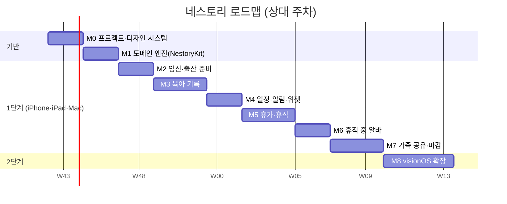

# 네스토리(Nestory) — TASKS (단일 문서)

> 작성: 2026-10-20 · 규칙: 마일스톤 하나씩 진행 → 회귀 확인 → 이 문서 체크 → 커밋 → 정지/보고
> 작업 규칙(다른 프로젝트와 시뮬레이터 공유): 사용 전 `xcrun simctl list devices booted` 로 확인, 전용 기기 `Nestory *` 만 사용, 다른 기기 종료·`killall`·CoreSimulator 재시작 금지. 가능하면 `swift test`·generic 빌드·macOS 프리뷰로 검증.
> 표기: `[ ]` 대기 · `[~]` 진행 · `[x]` 완료 · 🔒 사용자 결정/외부 작업 필요
> 트랙: **T**(기술) · **D**(디자인/에셋) · **P**(제도 데이터·검증) · **Q**(품질)

## 마일스톤 개요

(일정은 가늠용. 실제로는 마일스톤 완료 기준으로만 진행.)

---

## 🔒 사전 결정 (M0 시작 전)
- [x] D-01 앱 이름 **Nestory(네스토리)** 확정 (2026-10-20). 🔒 남은 것: 번들 ID(가안 `com.kimminung.nestory`), 개발 팀, App Store 이름·상표 중복 확인
- [ ] 🔒 D-02 최소 지원 OS 범위
- [ ] 🔒 D-03 한글 포인트 폰트 번들 여부 (Gowun Dodum / Jua / 시스템만)
- [ ] 🔒 D-04 수익 모델(v1 무료 전제 확인)
- [ ] 🔒 D-05 Blender 에셋 제작 경로: Claude Desktop 에 [BLENDER_ASSET_BRIEF.md](BLENDER_ASSET_BRIEF.md) 전달 (이 세션에서는 Blender MCP 미사용)
- [x] D-06 GitHub 레포 생성 (사용자가 GitHub Desktop 으로 생성, `~/Desktop/Nestory`)

---

## M0 · 프로젝트 기반 & 디자인 시스템
- [x] T0.1 프로젝트·타깃 `Nestory` 로 개명(템플릿 `MyApp`/`ContentView` 제거), 멀티플랫폼 단일 타깃(iOS·iPadOS·macOS, visionOS 목적지는 이미 포함), 번들 ID `com.kimminung.nestory`, 표시 이름 Nestory
- [x] T0.2 로컬 Swift 패키지 `Packages/NestoryKit`(제품 NestoryKit·NestoryData), `Packages/NestoryUI` 생성, 앱에 연결
- [~] T0.3 Swift 6 언어 모드·`.gitignore` 완료. 린트/포맷 규칙, LFS는 보류(LFS는 D7 에셋 반입 시점에 설정)
- [x] T0.4 String Catalog 초기화(앱·NestoryUI, 소스 언어 ko, 개발 지역 ko), `KoreanFormat`(₩·한국어 날짜) + 테스트
- [x] T0.5 `NestoryUI` 디자인 토큰: 색(라이트/다크/밤 `NestoryColor` ShapeStyle), 둥근 타이포, 간격, 모서리, 그림자, 카테고리 색·아이콘
- [x] T0.6 컴포넌트 1차: `NestoryCard`, `QuickLogButton`, `NestoryChip`, `EmptyState`, `DisclaimerBanner`, 주 버튼 스타일(모션 감소 대응)
- [x] T0.7 토큰 대비 테스트(WCAG AA 자동 검증, 15조합 × 라이트/다크/밤) — 결과로 `peachDeep`·`cocoaSoft`·`warning`·`danger` 값을 어둡게 조정(PRD_Design §3.1 반영)
- [x] T0.8 SwiftData 스키마 v1(17개 모델) + CloudKit 호환 규칙 자동 점검 테스트(기본값/옵셔널·inverse·unique 없음), 연쇄 삭제 테스트
- [x] T0.9 앱 셸: compact=`TabView`, regular=`NavigationSplitView`(iPad·Mac·visionOS), 구역별 자리 표시 화면, 저장소 실패 안내 화면
- [~] T0.10 컴포넌트 갤러리(더보기 > 디자인 갤러리, DEBUG 전용) + 프리뷰 4종(라이트/다크/밤/AX3). macOS 라이트·다크 렌더 확인. 🔒 iPhone·iPad 실제 화면 확인은 시뮬레이터 사용 협의 후(M1 이후)
- [x] Q0 macOS·iOS Simulator·visionOS Simulator 빌드 통과(generic 목적지), 패키지 테스트 11개 통과(NestoryKit 8 + NestoryUI 3)

## M1 · 도메인 엔진 (`NestoryKit`) — UI 없이 `swift test`
- [x] T1.1 `PregnancyCalculator`: LMP/초음파/IVF → 예정일, 주+일수, D-day, 삼분기
- [x] T1.2 `ScheduleGenerator` + `rules/prenatal.json`(검진·바우처·준비물·출생 후 행정 15항목). 출생일 모르면 예정일로 추정(`isEstimated`)
- [x] T1.3 `VaccineScheduler` + `rules/vaccine.json`(10종), 지연 시 다음 차수 최소 간격 따라잡기, 상태(완료/예정/가능/지연)
- [x] T1.4 영유아 건강검진 8회(`rules/infant-checkup.json`, `ScheduleGenerator` 공용)
- [x] T1.5 `GrowthPercentile` 엔진(z·백분위·역변환·보간·밴드). 🔒 LMS 데이터는 없음 → P1.3
- [x] T1.6 `LeaveEngine`: 규칙 로더 + 14가지 검증(출산전후·배우자·육아휴직 한도/자녀 연령·6+6·근로시간 단축·겹침) + 신청 마감일
- [x] T1.7 `IncomeSimulator`: 일 단위 안분, 종류 우선순위, 6+6 월별 상한, 근로시간 단축 지원, 부부 합산·기준선 대비 감소액
- [x] T1.8 `SideWorkGuard`: 육아휴직 중 근무일·월 소득·주 근로시간 임계 경고 + 사전 점검 4항목(판정 아님, 항상 고용센터 확인 안내)
- [x] T1.9 `NotificationPlanner`: D-7/D-1/당일, 조용한 시간 보정, 지난 알림 제거, 64개 한도
- [x] T1.10 `AgeFormatter`: "20주 3일", D-day, 생후 N일/만 N개월/만 N세, 백일·돌 (+ M0 `KoreanFormat`)
- [ ] P1.1 🔒 모든 규칙 수치를 **공식 출처로 검증**하고 `status: verified`·`verifiedAt` 기입 (`prenatal`·`infant-checkup`·`vaccine`·`leave` 4개 JSON 전부 `unverified` 초안). 특히 6+6 월별 상한, 근로시간 단축 지원금, 출생 후 행정 신청 기한, JE·Hib 차수
- [x] P1.2 규칙 JSON 스키마(`RuleMeta`: status·verifiedAt·출처) + 신선도 판정(180일 경계 테스트) + 번들 파일 일관성 테스트
- [x] Q1 경계값 테스트 95개(NestoryKit 90 + NestoryData 5), `NestoryKit` 라인 커버리지 97.2%, 3플랫폼 빌드·NestoryUI 테스트 회귀 없음
- [ ] P1.3 🔒 성장도표 LMS 가져오기: 질병관리청 2017 소아청소년 성장도표(체중·키·머리둘레·BMI, 성별, 월령) 공식 표 → `growth-lms.json` (추정값 입력 금지, 현재 `status: missing`)
- [ ] P1.4 가정 목록 확인: 소득 시뮬레이터(일 단위 안분, 중복 시 우선순위)·6+6(부모 모두 휴직 필요 가정)·출산전후휴가 소득(통상임금 100%, 상한 없음) 단순화가 실제 제도와 맞는지

## M2 · 임신·출산 준비 (P0)
- [x] T2.1 온보딩 5단계(환영→상태→예정일/출생일→이름→알림). 예정일 4가지 입력(생리일·초음파·시험관·직접)+검증 메시지, `FamilySetup`(NestoryData) 테스트
- [x] T2.2 임신 홈: 주차·D-day·분기·진행률 히어로, 이번 주 아기 크기, 다가오는 일정 4개(완료 체크), 바로가기 5개, 예정일 수정 시트
- [x] T2.3 주차 타임라인(14칸, 현재 주차 강조·자동 스크롤, 구간 내 검진·할 일). 과일 이미지는 D3 에셋 전까지 임시 아이콘(`assetName` 은 `week_NN_name` 규칙으로 준비됨)
- [x] T2.4 산전 검사: 권장 구간·상태 배지·완료 체크·메모·직접 추가/삭제
- [x] T2.5 체크리스트 4그룹 32항목(`rules/checklist-prenatal.json`)·진행률·사용자 항목 추가/삭제(길게 누름·우클릭). 순서 직접 정렬은 `sortIndex` 필드(스키마 V2)가 필요해 보류
- [x] T2.6 제도·지원금 카드(바우처·행정·휴가 계획): 신청 가능 시기·공식 링크(https)·완료 체크, "참고용·미검증" 배너
- [x] T2.7 태동 카운터(세션 저장·시간당 횟수), 진통 타이머(간격·지속 계산, 사용자 조정 가능한 "5-1-1" 참고 점검, 기록은 `@AppStorage` JSON — 스키마 변경 없음)
- [ ] T2.8 (P1) 산모 기록(체중·혈압·혈당) + 차트 — 새 모델이 필요해 스키마 V2 와 함께 진행(M3 이후로 이동)
- [ ] T2.9 (P1) 병원/조리원 연락처 — 새 모델이 필요해 스키마 V2 와 함께 진행(M3 이후로 이동)
- [~] Q2 테스트 130개(NestoryKit 108·NestoryData 19·NestoryUI 3), 커버리지 NestoryKit 97.5%·NestoryData 78.4%, 3플랫폼 빌드 경고 0, macOS 프리뷰로 10개 화면 렌더 확인. 🔒 iPhone·iPad 실화면, VoiceOver·Dynamic Type 감사는 미실시(시뮬레이터 협의 후)

## M3 · 육아 기록 (P0)
- [ ] T3.1 `CareLog` CRUD, 종류별 입력 시트
- [ ] T3.2 빠른 기록 버튼 + 햅틱, 최근 값 기억(분유 ml 등)
- [ ] T3.3 수유/수면 타이머, 백그라운드 복원, Live Activity
- [ ] T3.4 일간 타임라인 + 주간 요약 차트 (Swift Charts)
- [ ] T3.5 성장 기록 + 성장도표 백분위 곡선
- [ ] T3.6 예방접종 화면(완료 체크·다음 일정 알림)
- [ ] T3.7 영유아 건강검진 화면
- [ ] T3.8 홈(육아 모드) + 밤 수유 모드
- [ ] T3.9 (P1) 발달 이정표 + 사진, 앨범
- [ ] T3.10 (P1) 이유식·알레르기 로그
- [ ] T3.11 (P1) 자연어 입력(FoundationModels, 폴백 폼)
- [ ] T3.12 App Intents: "분유 기록", "수면 시작/종료"
- [ ] Q3 기록 10만 건 성능 측정, 수동 QA

## M4 · 일정·알림·위젯
- [ ] T4.1 통합 타임라인(검진·접종·휴직·알바·사용자 일정)
- [~] T4.2 로컬 알림 등록/갱신/취소 — M2 에서 `NotificationService`(권한·전체 재예약)와 일정 변경 감지 재예약까지 구현. 남은 것: 조용한 시간 사용자 설정, 실기기 검증
- [ ] T4.3 위젯: D-day, 다음 일정, 마지막 수유
- [ ] T4.4 Mac `MenuBarExtra` 빠른 기록
- [ ] T4.5 (P1) EventKit 내보내기
- [ ] T4.6 (P1) 돌봄 분담표
- [ ] Q4 알림 시나리오 점검(시간대 변경, 날짜 변경)

## M5 · 휴가·휴직
- [ ] T5.1 내 상황 입력 폼(근로형태·입사일·통상임금·가입 여부·다태아)
- [ ] T5.2 제도 카드 목록·상세(대상·기간·급여·신청 방법·출처·기준일)
- [ ] T5.3 휴직 플래너 간트(부부 2레인, 드래그 편집, 겹침/한도 경고)
- [ ] T5.4 급여 시뮬레이터 + 시나리오 3개 비교, 부부 합산
- [ ] T5.5 신청 마감·단계 체크리스트 + 알림
- [ ] T5.6 (P1) 연차·출근율 추정
- [ ] T5.7 (P1) 서류 보관함(암호화)
- [ ] T5.8 규칙 데이터 업데이트 경로(서명 JSON, 선택)
- [ ] P5.1 🔒 공식 출처로 시뮬레이션 결과 교차 검증(샘플 5건 이상)
- [ ] Q5 면책 문구·출처 노출 전수 확인

## M6 · 휴직 중 아르바이트
- [ ] T6.1 공고 보관(수동 입력 + 링크 붙여넣기 + Share Extension)
- [ ] T6.2 지원 칸반(관심→지원→면접→확정→종료)
- [ ] T6.3 근무 로그 + 월 합계
- [ ] T6.4 사전 점검 체크리스트(취업규칙·급여 영향·세금/4대보험·돌봄 공백)
- [ ] T6.5 영향 경고 배너(임계 설정, 판정 아님, 고용센터 안내)
- [ ] T6.6 (P1) 태그 필터(재택·단시간 등)
- [ ] T6.7 (P2) 공공 일자리 API 🔒 키 발급·약관 확인
- [ ] P6.1 🔒 휴직 중 취업 관련 공식 안내 문구 확보 후 점검표 문구 확정
- [ ] Q6 문구 검수("판정"으로 읽히는 표현 제거)

## M7 · 가족 공유 & 마감
- [ ] T7.1 스파이크: SwiftData + CloudKit 개인 DB 동기화 검증
- [ ] T7.2 스파이크: `CKShare` 공유(SwiftData 지원 범위 확인, 불충분 시 CKSyncEngine)
- [ ] T7.3 보호자 초대/권한(편집자·읽기 전용)
- [ ] T7.4 Face ID/암호 잠금
- [ ] T7.5 데이터 내보내기·전체 삭제
- [ ] T7.6 설정(단위·알림·조용한 시간·밤 모드)
- [ ] T7.7 개인정보 처리방침, 앱 개인정보 라벨, App Store 메타데이터(한글)
- [ ] T7.8 스크린샷(iPhone/iPad/Mac) 제작
- [ ] Q7 두 기기 공유 시나리오 QA, 접근성 3종 감사, 최종 회귀

## M8 · visionOS 확장 (2단계)
- [ ] T8.1 visionOS 목적지 추가, 공유 모듈 컴파일 확인
- [ ] T8.2 윈도우 UI(대형 타깃·호버 효과·글래스 카드)
- [ ] T8.3 성장 앨범(공간 사진 갤러리)
- [ ] T8.4 주차별 아기 크기 볼륨(RealityKit, USDZ)
- [ ] T8.5 휴직 플래너 대형 캔버스
- [ ] T8.6 (P2) 아기방 배치 몰입 경험
- [ ] T8.7 visionOS 앱 아이콘(3레이어) 적용
- [ ] Q8 시뮬레이터 + 가능하면 실기기 QA

---

## D 트랙 · 디자인/에셋 (Blender — Claude Desktop 에서 별도 진행) 🔒
- [ ] D1 마스코트 "네스티" 기본 모델 + 표정 7종 렌더
- [ ] D2 스티커 9종
- [ ] D3 과일 크기 14종
- [ ] D4 빈 화면 4장, 온보딩 3장
- [ ] D5 앱 아이콘: iOS(라이트/다크/틴티드), macOS, visionOS(3레이어), Icon Composer 레이어 PNG
- [ ] D6 USDZ: 네스티 + 과일(visionOS 볼륨용)
- [ ] D7 에셋 반입: `Design/Exports/` → 앱 `Assets.xcassets`, `NestoryUI` 스티커 번들
- [ ] D8 작은 크기(16~29pt) 아이콘 가독성 검토

## 문서 트랙
- [x] DOC1 Tech PRD ([PRD_Tech.md](PRD_Tech.md))
- [x] DOC2 Design PRD ([PRD_Design.md](PRD_Design.md))
- [x] DOC3 TASKS (본 문서)
- [x] DOC4 README (한글, 영문 접기, Mermaid 다이어그램)
- [x] DOC5 Blender 에셋 의뢰서 ([BLENDER_ASSET_BRIEF.md](BLENDER_ASSET_BRIEF.md))
- [ ] DOC6 레포 생성 후 README 배지·스크린샷 갱신

## 진행 로그
| 날짜 | 내용 |
|---|---|
| 2026-10-20 | M2 완료(P0+T2.7). 앱: `Onboarding/ Home/ Pregnancy/ Common/ More/ Support/` + 규칙 3개 추가(`pregnancy-weeks` `checklist-prenatal`, `prenatal.json` 링크). NestoryData: `PrenatalPlanSync`(규칙→SwiftData 멱등 동기화, 예정일 변경 시 미완료만 이동)·`FamilySetup`. **함정**: macOS 27 의 `List`(NSOutlineView)가 행 안에 `contentShape` 가 있는 버튼 2개(토글+상세)를 두면 `TableViewListCore_Mac2` 에서 크래시 → 검사·체크리스트는 `ScrollView`+카드로 구현(원인은 최소 예제로 좁혔으나 SDK 쪽 문제로 판단, 다른 List 화면은 정상). 스키마 변경(V2) 항목(산모 기록·연락처·정렬)은 보류. |
| 2026-10-20 | M1 완료(엔진). 구조: `Core/ Pregnancy/ Rules/ Vaccine/ Growth/ Leave/ SideWork/ Notifications/` + `Resources/rules/*.json`. 규칙 값은 전부 초안(unverified), 성장도표 LMS 는 데이터 없음(missing) — 웹 검증은 하지 않았음. 앱 UI 연결은 M2 부터. |
| 2026-10-20 | M0 완료. 구조: 앱 타깃 + `Packages/NestoryKit`(NestoryKit 순수 도메인 / NestoryData SwiftData 스키마) + `Packages/NestoryUI`. 설계 변경: `LeavePlan`은 가족 단위(두 보호자 기간을 함께 담음, `LeavePeriod.guardian` 으로 구분). 시뮬레이터는 쓰지 않음(빌드는 generic 목적지, 테스트는 `swift test`, 프리뷰는 macOS). |
| 2026-10-20 | 문서 5종 초안 작성. 정책 수치는 웹 검증 못함 → P1.1 로 구현 전 검증 필수. Blender 연결 생략(Claude Desktop 위임). 코드는 미착수. |
