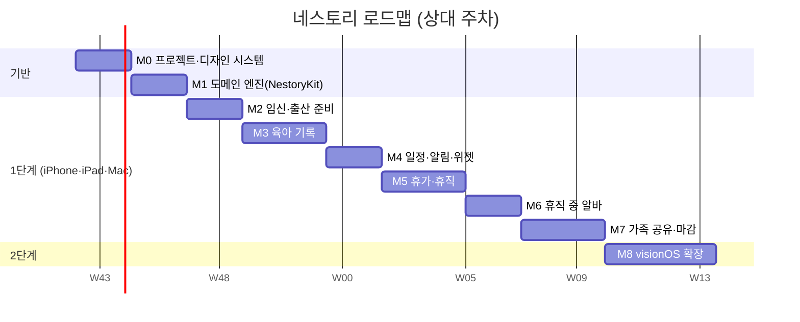

# 네스토리(Nestory) — TASKS (단일 문서)

> 작성: 2026-10-20 · 규칙: 마일스톤 하나씩 진행 → 회귀 확인 → 이 문서 체크 → 커밋 → 정지/보고
> 표기: `[ ]` 대기 · `[~]` 진행 · `[x]` 완료 · 🔒 사용자 결정/외부 작업 필요
> 트랙: **T**(기술) · **D**(디자인/에셋) · **P**(제도 데이터·검증) · **Q**(품질)

## 마일스톤 개요

(일정은 가늠용. 실제로는 마일스톤 완료 기준으로만 진행.)

---

## 🔒 사전 결정 (M0 시작 전)
- [x] D-01 앱 이름 **Nestory(네스토리)** 확정 (2026-10-20). 🔒 남은 것: 번들 ID(가안 `com.kimminung.nestory`), 개발 팀, App Store 이름·상표 중복 확인
- [ ] 🔒 D-02 최소 지원 OS 범위
- [ ] 🔒 D-03 한글 포인트 폰트 번들 여부 (Gowun Dodum / Jua / 시스템만)
- [ ] 🔒 D-04 수익 모델(v1 무료 전제 확인)
- [ ] 🔒 D-05 Blender 에셋 제작 경로: Claude Desktop 에 [BLENDER_ASSET_BRIEF.md](BLENDER_ASSET_BRIEF.md) 전달 (이 세션에서는 Blender MCP 미사용)
- [ ] 🔒 D-06 GitHub 레포 생성 (문서 완료 후 사용자 요청 시)

---

## M0 · 프로젝트 기반 & 디자인 시스템
- [ ] T0.1 기존 `MyApp` 을 `Nestory` 으로 개명, 멀티플랫폼(iOS·iPadOS·macOS) 단일 타깃 구성
- [ ] T0.2 로컬 Swift 패키지 `NestoryKit`, `NestoryUI` 생성, 앱 연결 (pbxproj 패키지 참조는 마지막에 일괄)
- [ ] T0.3 Swift 6 언어 모드, 린트/포맷 규칙, `.gitignore`, LFS(대용량 에셋) 설정
- [ ] T0.4 String Catalog 초기화(ko), `ko_KR` 로케일 유틸
- [ ] T0.5 `NestoryUI` 디자인 토큰: 색(라이트/다크/밤), 타이포, 간격, 모서리, 그림자
- [ ] T0.6 컴포넌트 1차: `NestoryCard`, `QuickLogButton`, `Chip`, `EmptyState`, `DisclaimerBanner`
- [ ] T0.7 토큰 대비 테스트(WCAG AA 자동 검증) — Swift Testing
- [ ] T0.8 SwiftData 스키마 v1 + CloudKit 호환 규칙 점검(옵셔널·기본값·무 unique)
- [ ] T0.9 앱 셸: iPhone `TabView`, iPad/Mac `NavigationSplitView`, 빈 화면들
- [ ] T0.10 컴포넌트 갤러리 프리뷰(3폼팩터 × 라이트/다크)
- [ ] Q0 빌드 3플랫폼 통과, 테스트 통과

## M1 · 도메인 엔진 (`NestoryKit`) — UI 없이 `swift test`
- [ ] T1.1 `PregnancyCalculator`: LMP/초음파/IVF → 예정일, 주+일수, D-day
- [ ] T1.2 `PrenatalScheduleRules` → 검진·바우처·준비물 자동 생성 (rules/prenatal.json)
- [ ] T1.3 `VaccineScheduler` (rules/vaccine.json), 생일 기준 일정·지연 접종 보정
- [ ] T1.4 `CheckupScheduler` 영유아 건강검진 시기
- [ ] T1.5 `GrowthPercentile` (LMS 데이터 → 백분위, z-score), 성별·월령 보간
- [ ] T1.6 `LeaveEngine`: RuleSet 로더 + 제도별 가능 기간/한도/겹침 검증
- [ ] T1.7 `IncomeSimulator`: 월별 급여·상한·하한, 부부 합산, 시나리오 비교
- [ ] T1.8 `SideWorkGuard`: 임계 설정 기반 경고 판단(판정 아님)
- [ ] T1.9 `NotificationPlanner`: 일정 → 알림 스케줄(D-7/D-1/당일, 조용한 시간)
- [ ] T1.10 `AgeFormatter`: "만 N개월", "N주 M일", 한국어 날짜
- [ ] P1.1 🔒 모든 규칙 수치를 **공식 출처로 검증**하고 `verifiedAt`·`sourceURL` 기입 (PRD_Tech §2.4.1 표는 미검증 초안)
- [ ] P1.2 규칙 JSON 스키마 + 만료(180일) 경고 테스트
- [ ] Q1 경계값 테스트 표(예정일·주차·접종 간격·휴직 겹침·급여 상한), 커버리지 보고

## M2 · 임신·출산 준비 (P0)
- [ ] T2.1 온보딩: 가족 → 상태(임신/출산) → 예정일 → 알림 허용
- [ ] T2.2 홈(임신 모드): 주차 히어로 + 다음 할 일
- [ ] T2.3 주차 타임라인 + 과일 크기 카드(에셋 연동, 임시 SF Symbol 대체)
- [ ] T2.4 산전검사 목록·완료 체크·메모
- [ ] T2.5 체크리스트(출산 준비물·입원 가방·행정), 사용자 항목 추가/정렬
- [ ] T2.6 바우처·지원금 안내 카드(링크, 신청 시점)
- [ ] T2.7 (P1) 태동 카운터, 진통 타이머
- [ ] T2.8 (P1) 산모 기록(체중·혈압·혈당) + 차트
- [ ] T2.9 (P1) 병원/조리원 연락처
- [ ] Q2 3플랫폼 수동 QA, 접근성 감사

## M3 · 육아 기록 (P0)
- [ ] T3.1 `CareLog` CRUD, 종류별 입력 시트
- [ ] T3.2 빠른 기록 버튼 + 햅틱, 최근 값 기억(분유 ml 등)
- [ ] T3.3 수유/수면 타이머, 백그라운드 복원, Live Activity
- [ ] T3.4 일간 타임라인 + 주간 요약 차트 (Swift Charts)
- [ ] T3.5 성장 기록 + 성장도표 백분위 곡선
- [ ] T3.6 예방접종 화면(완료 체크·다음 일정 알림)
- [ ] T3.7 영유아 건강검진 화면
- [ ] T3.8 홈(육아 모드) + 밤 수유 모드
- [ ] T3.9 (P1) 발달 이정표 + 사진, 앨범
- [ ] T3.10 (P1) 이유식·알레르기 로그
- [ ] T3.11 (P1) 자연어 입력(FoundationModels, 폴백 폼)
- [ ] T3.12 App Intents: "분유 기록", "수면 시작/종료"
- [ ] Q3 기록 10만 건 성능 측정, 수동 QA

## M4 · 일정·알림·위젯
- [ ] T4.1 통합 타임라인(검진·접종·휴직·알바·사용자 일정)
- [ ] T4.2 로컬 알림 등록/갱신/취소 (규칙 변경 시 재계획)
- [ ] T4.3 위젯: D-day, 다음 일정, 마지막 수유
- [ ] T4.4 Mac `MenuBarExtra` 빠른 기록
- [ ] T4.5 (P1) EventKit 내보내기
- [ ] T4.6 (P1) 돌봄 분담표
- [ ] Q4 알림 시나리오 점검(시간대 변경, 날짜 변경)

## M5 · 휴가·휴직
- [ ] T5.1 내 상황 입력 폼(근로형태·입사일·통상임금·가입 여부·다태아)
- [ ] T5.2 제도 카드 목록·상세(대상·기간·급여·신청 방법·출처·기준일)
- [ ] T5.3 휴직 플래너 간트(부부 2레인, 드래그 편집, 겹침/한도 경고)
- [ ] T5.4 급여 시뮬레이터 + 시나리오 3개 비교, 부부 합산
- [ ] T5.5 신청 마감·단계 체크리스트 + 알림
- [ ] T5.6 (P1) 연차·출근율 추정
- [ ] T5.7 (P1) 서류 보관함(암호화)
- [ ] T5.8 규칙 데이터 업데이트 경로(서명 JSON, 선택)
- [ ] P5.1 🔒 공식 출처로 시뮬레이션 결과 교차 검증(샘플 5건 이상)
- [ ] Q5 면책 문구·출처 노출 전수 확인

## M6 · 휴직 중 아르바이트
- [ ] T6.1 공고 보관(수동 입력 + 링크 붙여넣기 + Share Extension)
- [ ] T6.2 지원 칸반(관심→지원→면접→확정→종료)
- [ ] T6.3 근무 로그 + 월 합계
- [ ] T6.4 사전 점검 체크리스트(취업규칙·급여 영향·세금/4대보험·돌봄 공백)
- [ ] T6.5 영향 경고 배너(임계 설정, 판정 아님, 고용센터 안내)
- [ ] T6.6 (P1) 태그 필터(재택·단시간 등)
- [ ] T6.7 (P2) 공공 일자리 API 🔒 키 발급·약관 확인
- [ ] P6.1 🔒 휴직 중 취업 관련 공식 안내 문구 확보 후 점검표 문구 확정
- [ ] Q6 문구 검수("판정"으로 읽히는 표현 제거)

## M7 · 가족 공유 & 마감
- [ ] T7.1 스파이크: SwiftData + CloudKit 개인 DB 동기화 검증
- [ ] T7.2 스파이크: `CKShare` 공유(SwiftData 지원 범위 확인, 불충분 시 CKSyncEngine)
- [ ] T7.3 보호자 초대/권한(편집자·읽기 전용)
- [ ] T7.4 Face ID/암호 잠금
- [ ] T7.5 데이터 내보내기·전체 삭제
- [ ] T7.6 설정(단위·알림·조용한 시간·밤 모드)
- [ ] T7.7 개인정보 처리방침, 앱 개인정보 라벨, App Store 메타데이터(한글)
- [ ] T7.8 스크린샷(iPhone/iPad/Mac) 제작
- [ ] Q7 두 기기 공유 시나리오 QA, 접근성 3종 감사, 최종 회귀

## M8 · visionOS 확장 (2단계)
- [ ] T8.1 visionOS 목적지 추가, 공유 모듈 컴파일 확인
- [ ] T8.2 윈도우 UI(대형 타깃·호버 효과·글래스 카드)
- [ ] T8.3 성장 앨범(공간 사진 갤러리)
- [ ] T8.4 주차별 아기 크기 볼륨(RealityKit, USDZ)
- [ ] T8.5 휴직 플래너 대형 캔버스
- [ ] T8.6 (P2) 아기방 배치 몰입 경험
- [ ] T8.7 visionOS 앱 아이콘(3레이어) 적용
- [ ] Q8 시뮬레이터 + 가능하면 실기기 QA

---

## D 트랙 · 디자인/에셋 (Blender — Claude Desktop 에서 별도 진행) 🔒
- [ ] D1 마스코트 "네스티" 기본 모델 + 표정 7종 렌더
- [ ] D2 스티커 9종
- [ ] D3 과일 크기 14종
- [ ] D4 빈 화면 4장, 온보딩 3장
- [ ] D5 앱 아이콘: iOS(라이트/다크/틴티드), macOS, visionOS(3레이어), Icon Composer 레이어 PNG
- [ ] D6 USDZ: 네스티 + 과일(visionOS 볼륨용)
- [ ] D7 에셋 반입: `Design/Exports/` → 앱 `Assets.xcassets`, `NestoryUI` 스티커 번들
- [ ] D8 작은 크기(16~29pt) 아이콘 가독성 검토

## 문서 트랙
- [x] DOC1 Tech PRD ([PRD_Tech.md](PRD_Tech.md))
- [x] DOC2 Design PRD ([PRD_Design.md](PRD_Design.md))
- [x] DOC3 TASKS (본 문서)
- [x] DOC4 README (한글, 영문 접기, Mermaid 다이어그램)
- [x] DOC5 Blender 에셋 의뢰서 ([BLENDER_ASSET_BRIEF.md](BLENDER_ASSET_BRIEF.md))
- [ ] DOC6 레포 생성 후 README 배지·스크린샷 갱신

## 진행 로그
| 날짜 | 내용 |
|---|---|
| 2026-10-20 | 문서 5종 초안 작성. 정책 수치는 웹 검증 못함 → P1.1 로 구현 전 검증 필수. Blender 연결 생략(Claude Desktop 위임). 코드는 미착수. |
