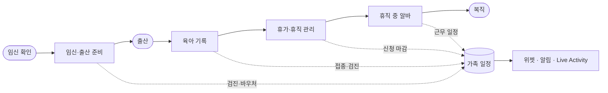
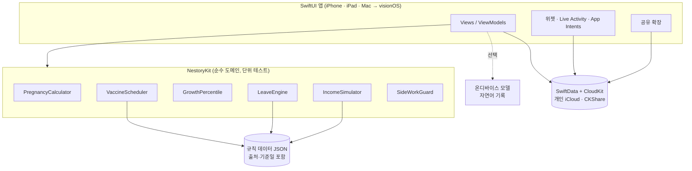
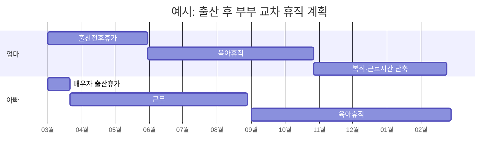
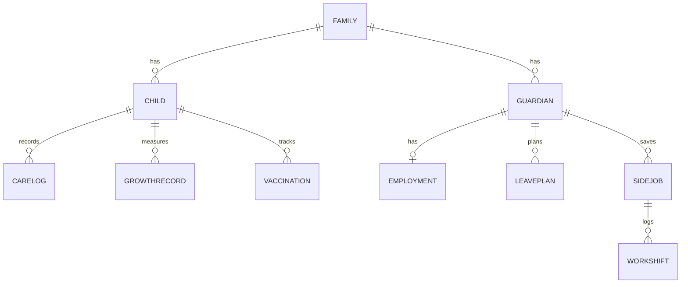
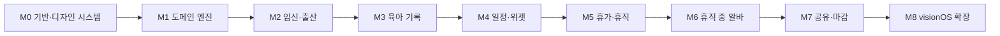

# 🧸 Nestory (네스토리)

**아이를 기다리는 날부터 함께 자라는, 우리 가족 육아 도구**

*Nest(둥지) + Story(이야기) — 우리 아이의 둥지에서 쓰는 육아일기*

임신 준비 · 육아 기록 · 가족 일정 · 휴가·휴직 · 휴직 중 아르바이트까지
iPhone · iPad · Mac, 그리고 Apple Vision Pro

`SwiftUI` `SwiftData` `CloudKit` `WidgetKit` `FoundationModels` `visionOS`

> 상태: **M1 완료**(도메인 엔진: 임신·접종·성장·휴직·소득·알림 계산, 테스트 95개) · 2026-10-20

---

## 📖 목차
1. [앱 소개](#-앱-소개)
2. [주요 기능](#-주요-기능)
3. [다이어그램](#-다이어그램)
4. [이럴 때 쓰세요 (활용 아이디어)](#-이럴-때-쓰세요-활용-아이디어)
5. [플랫폼과 로드맵](#-플랫폼과-로드맵)
6. [개인정보 원칙](#-개인정보-원칙)
7. [문서](#-문서)
8. [유의 사항](#-유의-사항)
9. [English](#english)

---

## 🌱 앱 소개

아이가 생기면 챙길 것이 갑자기 늘어납니다. 산전검사 일정, 바우처 신청, 출산 준비물, 새벽 수유 기록, 예방접종, 그리고 **누가 언제 얼마나 휴직할지** 같은 현실적인 고민까지요.

**네스토리**은 이 모든 것을 부부가 함께 보는 한 곳에 모읍니다.

- 🗓 **임신 주차로 할 일이 자동 생성**됩니다.
- 🍼 **3번 탭으로 육아 기록**을 남기고 패턴을 봅니다.
- 💼 **출산전후휴가·배우자 출산휴가·육아휴직**을 부부 타임라인에 올려 놓고 예상 소득을 비교합니다.
- 🧩 **휴직 중 아르바이트** 공고와 근무·수입을 모으고, 급여에 영향을 줄 수 있는 신호를 미리 알려 줍니다.
- 🔒 모든 데이터는 **내 기기와 개인 iCloud**에만 있습니다.

아기자기한 파스텔 클레이 디자인과 마스코트 **네스티**가 불안한 시기를 조금 더 포근하게 만들어 줍니다.

## ✨ 주요 기능

| 모듈 | 하는 일 |
|---|---|
| 🤰 **임신·출산 준비** | 출산예정일 계산, 주차별 아기 크기(과일 비유), 산전검사·바우처 일정, 입원 가방·준비물 체크리스트, 태동 카운터·진통 타이머 |
| 🍼 **육아 기록** | 수유·수면·기저귀·체온·투약, 타이머와 Live Activity, 일간·주간 차트, 성장도표 백분위, 예방접종·영유아 검진, 발달 이정표·앨범 |
| 🗓 **가족 일정** | 검진·접종·휴직·알바를 하나의 타임라인으로, 알림, 위젯, 돌봄 분담표 |
| 💼 **휴가·휴직** | 제도 카드(대상·기간·급여·신청), 부부 휴직 플래너(간트), 급여 시뮬레이터, 신청 마감 알림 |
| 🧩 **휴직 중 알바** | 공고 보관(공유 시트로 저장), 지원 칸반, 근무 로그, 사전 점검 체크리스트, 영향 경고 |
| 👨‍👩‍👧 **가족 공유** | 보호자 초대(편집/읽기 전용), 아이 여러 명, 잠금, 내보내기 |

## 🗺 다이어그램

### 1) 가족의 여정과 네스토리의 모듈

### 2) 앱 아키텍처

### 3) 부부 휴직 플래너 예시 (샘플 시나리오)

> 날짜·기간은 설명용 샘플이며 실제 제도 기준과 다를 수 있습니다.

### 4) 데이터 모델 (요약)

### 5) 플랫폼 로드맵

## 💡 이럴 때 쓰세요 (활용 아이디어)

- **새벽 3시 수유**: 밤 모드 + 큰 타이머로 한 손 기록, 배우자는 마지막 수유 시각을 위젯에서 확인.
- **부부 휴직 협상**: 육아휴직을 누가 언제 쓰면 가계 소득이 얼마나 달라지는지 시나리오 3개로 비교해 회사와 상의.
- **병원 진료 전날**: 최근 2주 체온·수유·수면 요약을 한 화면에서 확인(향후 PDF 내보내기).
- **조부모 돌봄 요청**: 읽기 전용으로 초대해 오늘의 일정·알레르기·응급 연락처 공유.
- **휴직 중 소득 공백**: 재택·단시간 공고를 모으고 지원 상태를 칸반으로 관리, 급여에 영향을 줄 수 있으면 먼저 고용센터 확인.
- **쌍둥이·둘째**: 아이별 기록·접종 일정을 분리하되 부모 일정은 하나로.
- **산후 우울 예방 루틴**: 하루 중 '나를 위한 시간' 체크리스트를 일정에 넣기(향후 아이디어).
- **100일·돌 준비**: 마일스톤 기록과 사진이 자동으로 기념 카드가 됨.
- **Vision Pro(확장)**: 공간 사진 성장 앨범, 주차별 아기 크기 3D 비교, 아기방 가구 배치 미리 보기.
- **복직 준비**: 복직 D-day, 근로시간 단축 계획, 어린이집 입소 일정을 한 타임라인에.

## 🖥 플랫폼과 로드맵

| 단계 | 대상 | 내용 |
|---|---|---|
| 1단계 | iPhone · iPad · macOS | 단일 SwiftUI 코드베이스, 폼팩터별 레이아웃(탭 / 분할 보기 / 사이드바+메뉴바) |
| 2단계 | visionOS | 윈도우 + 볼륨 + 몰입 공간 확장 |

아이콘·마스코트·스티커는 Blender 로 제작하며 플랫폼별 아이콘(iOS 라이트/다크/틴티드, macOS, visionOS 3레이어)을 포함합니다.

## 🔐 개인정보 원칙
- 아기 건강·성장, 부모 고용·소득은 민감 정보로 다룹니다.
- 자체 서버·광고·분석 SDK 없음. 데이터는 기기 + 개인 iCloud.
- AI 기능은 온디바이스에서만 동작하고 의료 조언을 하지 않습니다.
- Face ID/암호 잠금, 데이터 내보내기·전체 삭제 제공.

## 📚 문서

| 문서 | 내용 |
|---|---|
| [Docs/PRD_Tech.md](Docs/PRD_Tech.md) | 기능 범위, 아키텍처, 데이터 모델, 규칙 데이터, 플랫폼, 보안, 품질 |
| [Docs/PRD_Design.md](Docs/PRD_Design.md) | 디자인 원칙, 마스코트, 색·타이포, 컴포넌트, 화면, 플랫폼별 UX, 아이콘 |
| [Docs/TASKS.md](Docs/TASKS.md) | 마일스톤 M0~M8 단일 태스크 문서 |
| [Docs/BLENDER_ASSET_BRIEF.md](Docs/BLENDER_ASSET_BRIEF.md) | Blender 에셋·아이콘 제작 의뢰서 |

## ⚠️ 유의 사항
- 앱의 제도·금액 계산은 **참고용**입니다. 법령·지침은 바뀔 수 있으며, 화면마다 기준일과 출처를 함께 표시합니다. 확정 안내는 고용24, 고용센터(1350), 사업장 인사팀, 노무사에게 확인하세요.
- 의료적 판단을 대신하지 않습니다. 응급 상황에서는 119 또는 병원에 연락하세요.
- 휴직 중 취업 관련 기능은 수급 가능 여부를 **판정하지 않고** 확인 항목만 안내합니다.
- 현재 문서에 적힌 제도 수치는 구현 전 공식 출처로 검증해야 하는 초안입니다.

---

<b>🌐 English version (click to expand)</b>

# 🧸 Nestory

**A cozy, detailed toolkit for families expecting a baby — from the first positive test to going back to work.**

Prenatal prep · baby care logs · family schedule · leave & parental-leave planning · side-work tracking during leave.
Built with SwiftUI for iPhone, iPad and Mac first, then extended to Apple Vision Pro. Korean-market first.

> Status: **M1 done** (domain engine: pregnancy, vaccines, growth, leave, income, notifications; 95 tests) · 2026-10-20

## Overview
Nestory gathers everything a Korean family has to juggle around a new baby into one shared place for both parents:

- Pregnancy-week-driven to-dos (checkups, vouchers, packing lists)
- Three-tap baby logs: feeding, sleep, diapers, temperature, medication, growth, vaccinations
- A shared family timeline with reminders, widgets and Live Activities
- Leave planning: maternity, paternity, parental leave, reduced working hours — with a two-parent timeline and income simulator
- Side-work tracker during leave: saved listings, application kanban, shift/income log, pre-check list and "check with the employment center" warnings (the app never rules on eligibility)
- Privacy-first: on-device data plus the user's private iCloud; no servers, ads or analytics SDKs

The design is a pastel "clay doll" world with a bear mascot named **Nesty**.

## Features
| Module | What it does |
|---|---|
| Prenatal | Due-date calculator, weekly fruit-size cards, checkup/voucher schedule, checklists, kick counter, contraction timer |
| Care | Feeding/sleep/diaper/health logs, timers, charts, growth percentiles, vaccines, well-baby checkups, milestones & album |
| Schedule | Unified timeline, notifications, widgets, care-sharing plan |
| Leave | Program cards, couple's leave planner (Gantt), income simulator, deadline reminders |
| Side work | Listing vault (share sheet), kanban, shift log, pre-check, impact warnings |
| Family | Guardian invites (editor/read-only), multiple children, lock, export |

## Diagrams
See the Mermaid diagrams above (journey, architecture, leave planner, data model, roadmap).

## Use cases
Night-feeding mode with a big timer; comparing three leave scenarios before talking to your employer; a read-only invite for grandparents; collecting remote/part-time listings during leave; twins and second children; 100-day/first-birthday cards; spatial photo albums and 3D week-by-week size comparisons on Vision Pro.

## Platforms & roadmap
Phase 1: iPhone, iPad, macOS (single SwiftUI codebase). Phase 2: visionOS (windows, volumes, immersive space). Icons, mascot and stickers are produced in Blender, including platform-specific app icons.

## Privacy
Health and employment/income data are treated as sensitive. No custom servers or third-party SDKs. AI features run on-device only and never give medical advice.

## Docs
[Tech PRD](Docs/PRD_Tech.md) · [Design PRD](Docs/PRD_Design.md) · [Tasks](Docs/TASKS.md) · [Blender asset brief](Docs/BLENDER_ASSET_BRIEF.md)

## Disclaimer
Leave/benefit calculations are informational only; rules change, so each screen shows its effective date and source. Verify with official channels (Employment24, Employment Center 1350, HR, a labor attorney). Not medical advice; in an emergency call 119.

